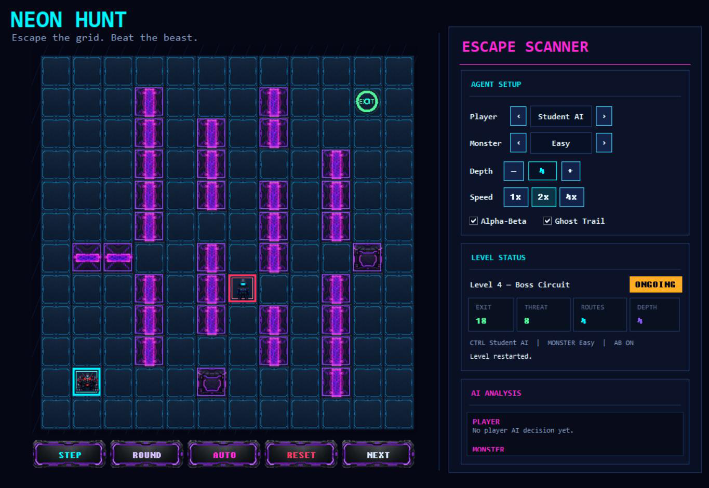

# Neon Hunt

A grid-based escape game for teaching adversarial search. The player, a Hacker, has to reach the exit or survive until the level ends while the Cyber Beast tries to catch them. Students write the Hacker's AI with an evaluation function, Minimax and Alpha-Beta pruning.

I designed and built it as a teaching assistant for **AI Fundamentals and Applications** (University of Isfahan, Spring 2026), where it was the third course project. This repository is the student release. The same code is also published in the course organisation: [UI-AIFA-4042/minmax-project](https://github.com/UI-AIFA-4042/minmax-project).

<p align="center">
  
</p>

## The game

- A grid with walls, an exit, the Hacker (player) and the Cyber Beast (monster). Both move one cell up, down, left or right, and the Beast moves after the Hacker.
- Four public levels, from *Neon Alley* to *Boss Circuit*.
- The Beast is driven by an instructor-written Alpha-Beta search. Its depth sets the difficulty: Easy 2, Normal 4, Hard 6, Boss 7.
- The Escape Scanner panel lets you pick the player (Human with the arrow keys, or Student AI), the monster difficulty, the search depth and the speed, switch Alpha-Beta on and off, show a ghost trail, and read the AI analysis.

## The student task

Complete the AI in [`neon_hunt/ai/student_player_ai.py`](neon_hunt/ai/student_player_ai.py):

- `evaluate(state)`
- `minimax(state, depth, maximizing_player, stats=None)`
- `alpha_beta(state, depth, alpha, beta, maximizing_player, stats=None)`
- `choose_player_move(state, depth, use_alpha_beta=True)`

The rule helpers (`get_possible_moves`, `apply_move`, `is_terminal`) are provided in `student_support.py`. Until the search functions are implemented the template raises `NotImplementedError`, so play as Human to try the game first.

## Run

```bash
python main.py
```

It needs Python 3 with `tkinter` (part of the standard Python installers) and nothing else. On Windows you can also run `run_windows.bat`.

## Layout

```
Neon-Hunt/
├── main.py
├── run_windows.bat
├── neon_hunt/
│   ├── app.py                    # the tkinter interface
│   ├── engine.py                 # rules, BFS distance, escape routes
│   ├── state.py, levels.py, config.py
│   ├── assets/                   # tiles, characters, obstacles, effects, UI images
│   └── ai/
│       ├── student_player_ai.py  # the file students complete
│       ├── student_support.py    # move helpers given to students
│       └── instructor_monster_ai.py  # the Cyber Beast (Alpha-Beta)
└── docs/
    └── Neon_Hunt_Student_Guide.pdf   # the full assignment, in Persian
```

## What is not in this repository

The instructor-side autograder, the hidden grading levels, the reference solutions and the students' submissions are kept private on purpose. Submissions were graded by an autograder that checks the required functions and the evaluation function, compares the search against a reference implementation, plays the agent on hidden levels, and caps the score of agents that do not really use adversarial search.

## Author

Fatemeh Sayadzadeh — [GitHub](https://github.com/Ftm-Sayadzadeh)
